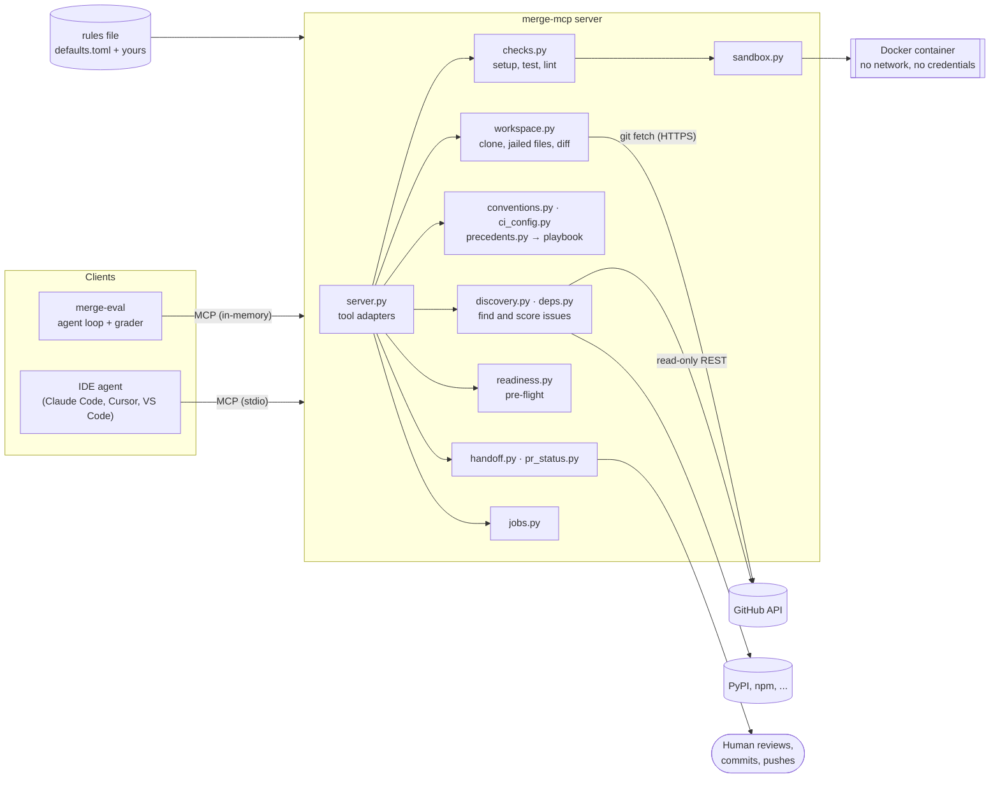

# Architecture

merge-mcp is two programs that share one codebase:

1. **The MCP server** (`merge-mcp`): tools an AI client calls to find an available
   issue, set up a workspace, learn how the repo is built and what its merged changes
   contain, run its tests in a sandbox, pre-flight the diff, prepare a pull request draft
   for a human, and follow the pull request afterwards. It works for any language.
2. **The evaluation harness** (`merge-eval`): a headless agent loop that drives that
   same server over MCP against real, already-solved issues and grades the outcome by
   running the maintainers' tests.

In an IDE you do not control the agent, so you cannot measure it. The harness exists so
the server's usefulness can be measured with an agent you do control.

## Module map

| Module | Responsibility | I/O |
|---|---|---|
| `server.py` | Tool definitions. Validates input, calls a service, returns a typed model. No logic. | MCP |
| `models.py` | Every tool input and output as a Pydantic model. This is the public contract. | none |
| `rules.py` + `defaults.toml` | The tunable policy as validated data: scoring weights, ecosystems, CI patterns, file categories. | filesystem |
| `discovery.py` | Issue search and the viability score. Fact gathering is separate from scoring. | GitHub API |
| `deps.py` | Dependency manifests to GitHub repos to available issues. | registries, GitHub API |
| `ci_config.py` | Reads CI workflows into install, test and lint commands for any language. | filesystem |
| `conventions.py` | Resolves commands (override, then CI, then ecosystem rule) and builds the playbook. | filesystem, git |
| `precedents.py` | Learns co-change rules from history; finds example commits. | git |
| `readiness.py` | Pre-flights a diff against the playbook. A pure function. | none |
| `workspace.py` | Clone, branch, path-jailed file access, diff. | filesystem, git |
| `checks.py` | Builds setup/test/lint commands; optional per-test parsers. | via `Runner` |
| `sandbox.py` | `Runner` interface with `DockerRunner` and `LocalRunner`. | Docker |
| `jobs.py` | Background jobs with pollable handles. | filesystem |
| `handoff.py` | The pull request draft and checklist. The last step before the human. | filesystem |
| `pr_status.py` | Reads CI and reviews on an open pull request into next actions. | GitHub API |
| `eval/` | Task format, miner, validator, agent loop, providers, grader, metrics, CLI. | all of the above |

`server.py` holds no logic on purpose. Every service module is plain Python that is unit
tested without MCP, and `tests/test_server.py` then checks the wiring through a real MCP
client.

## State model: handles, not sessions

The server keeps nothing per connection. Anything that must survive between calls is
referenced by a handle the server mints and the client passes back as a normal argument:

- `workspace_id` (`ws_…`): a directory under `~/.merge-mcp/workspaces/` holding
  `meta.json`, `playbook.json`, `checks.json` and the checkout.
- `job_id` (`job_…`): a background task. Finished jobs are written to disk.

This follows the direction of the MCP specification, whose 2026-07-28 revision removed
protocol-level sessions and tells servers to use explicit handles for cross-call state.
It also has practical benefits: a server restart loses nothing, two clients can work on
the same workspace, and an evaluation run is reproducible because every call names its
target.

## Long-running work

Cloning, installing dependencies and running tests take from seconds to minutes. Those
tools (`start_workspace`, `start_check`) return a `JobHandle` at once; `get_job` polls,
and can long-poll for up to 60 seconds so an agent usually needs one or two calls.

MCP has a Tasks extension for this. Explicit job tools were chosen because every client
can call two ordinary tools, while Tasks support differs between clients. See
[design-decisions.md](design-decisions.md#3-explicit-job-tools-instead-of-mcp-tasks).

## How commands are resolved

`conventions.resolve_tooling` decides how to install, test and lint a repo, in this order:

1. **Overrides** passed to `start_workspace`.
2. **The repo's CI workflow.** `ci_config.read_ci` ranks the jobs that run tests (jobs
   triggered by pushes and pull requests beat scheduled ones; plain names beat specialised
   ones such as `nightly` or `miri`), collapses the matrix to one Linux combination with
   the newest stable toolchain, and classifies each command as install, test or lint.
   Commands that need secrets, sudo or another OS are dropped and reported.
3. **The ecosystem rule** matched by marker file or dominant file extension, optionally
   refined by a detector hook.

The result records where it came from (`source`), the sandbox image for that toolchain,
and the environment that keeps caches inside the checkout. If CI-derived setup fails,
`Services.run_check` falls back once to step 3 and notes that in the playbook.

## A request, end to end

`start_check(workspace_id, kind="test")`:

1. `server.py` starts a job that calls `Services.run_check`.
2. `checks.build_command` takes the test command from the playbook. If the runner accepts
   test ids (pytest does), ids are shell-quoted and ids that look like options are refused.
3. `DockerRunner` runs it in a new container using the playbook's image: checkout mounted
   at `/work`, network off, capabilities dropped, CPU/memory/process limits, non-root user,
   hard timeout.
4. The exit code decides pass or fail. If the ecosystem names a result parser, per-test
   outcomes are parsed from the complete output.
5. The result and a fingerprint of the current diff are saved to `checks.json`, so
   `check_readiness` and `prepare_pull_request` can tell whether tests passed on *this
   exact* diff or an older one.

After `kind="setup"`, any untracked files that installation created (lockfiles, build
output) are added to the workspace's git exclude list, so they never appear in the diff.
That works for every toolchain without naming one.

## What is deliberately absent

- No commit, push, fork or pull request tool. See [security.md](security.md).
- No arbitrary shell tool. Agents can run the repo's setup, tests and linter, nothing else.
- No LLM inside the server. Scores, playbooks and pre-flight findings are computed by
  rules, so they are reproducible and free. The only LLM is the client's.
- No language names in the logic. Languages are entries in the rules file.
